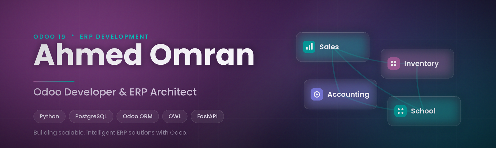

<h1 align="center">Hello, I'm Ahmed Omran </h1>
<h3 align="center">Odoo Developer & ERP Architect 🌍</h3>

  
  
  
  

I build **production-ready ERP solutions** with Odoo — from data models and
business logic to views, security, reports and integrations. I care about clean
architecture, real-world workflows and shipping things that work.

---

## 🌟 Featured Project: OdooGen

I am the creator of [**OdooGen**](https://github.com/Ahmed-Samy-Omran/Odoo-Generation-),
an AI-orchestrated platform designed to automate Odoo module architecture.

> **Impact:** Bridges the gap between business requirements and technical execution,
> allowing rapid generation of production-ready Odoo modules with visual ERD support.

---

## 🚀 Selected Projects

| Project | Description | Stack |
| --- | --- | --- |
| [**OdooGen**](https://github.com/Ahmed-Samy-Omran/Odoo-Generation-) | AI platform that generates production-ready Odoo modules with visual ERD support | Python · FastAPI · LLM |
| [**School Management**](https://github.com/Ahmed-Samy-Omran/school_management) | Odoo 19 student registry with computed age, validations, filters and archiving | Odoo 19 · Python |
| [**Porcelia Equipment Loan**](https://github.com/Ahmed-Samy-Omran/porcelia_equipment_loan_odoo19) | Odoo 19 module for equipment lending, condition tracking and overdue penalties | Odoo 19 · Python |
| [**Odoo Groove**](https://github.com/Ahmed-Samy-Omran/Odoo-Groove) | One-click Odoo developer-mode toggle for Chrome & Edge (Manifest V3, AR/EN) | JavaScript · MV3 |
| [**Tabl-Eat**](https://github.com/Ahmed-Samy-Omran/tabl-eat) | Branch order-management platform with full request workflow and live demo | React · Vite · Tailwind |
| [**Exam System**](https://github.com/Ahmed-Samy-Omran/Exam_sysytem) | Exam management system with a documented design system and E2E tests | TypeScript · React |

---

## 👨‍💻 Technologies I Work With

### 💜 Odoo & ERP Ecosystem

- **Core Odoo**: Python, PostgreSQL, Odoo ORM, XML Views, QWeb Reports.
- **Advanced Backend**: FastAPI, Asynchronous Programming, REST APIs.
- **AI Integration**: LLM Orchestration (Gemini, OpenRouter), RAG (ChromaDB, Sentence Transformers).
- **Automation**: GitHub API Integration, Docker for CI/CD.

### 📱 Android Development

- **Languages**: Kotlin, Java ☕
- **Architecture**: MVVM, Clean Architecture, Jetpack Compose ✨
- **Reactive**: Coroutines, Flow, StateFlow ⚡
- **Storage & Networking**: Retrofit, Room, Firebase 🔥, Google Maps SDK 🗺️
- **DI**: Hilt, Koin 🧳

---

## 🛠️ Languages and Tools

  
  
  
  
  
  
  
  
  

---

## 📊 GitHub Stats

  
  
  

  

  

---

## 📫 Connect with Me

- 📧 **Email**: [omranahmed385@gmail.com](mailto:omranahmed385@gmail.com)
- 💼 **LinkedIn**: [Ahmed Omran](https://www.linkedin.com/in/ahmed-omran-a73621256/)
- 📄 **Odoo CV**: [View CV](https://drive.google.com/file/d/17SYdUyOJGUsrUvZiWU8tFzZDkQX9MrvT/view?usp=sharing)
- 📄 **Android CV**: [View CV](https://drive.google.com/file/d/1kkgm8LPcfYWITQJ9D4aDQjMZxec4kSK7/view?usp=sharing)

---

*“Crafting intelligent ERPs and seamless mobile experiences.”* 🚀
